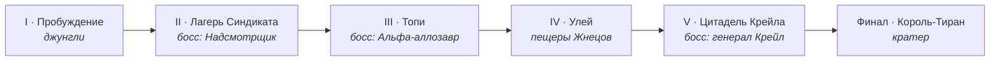

<div align="center">


# Первобытный рубеж

**Браузерный 3D-шутер про охоту на динозавров, наёмников и пришельцев.**<br>
Шесть глав сюжета, 11 видов оружия, 19 типов врагов. Без установки — открывается в браузере.

[](https://hpainh.github.io/pervobytny-rubezh/)
[](../../releases/latest)


</div>

---

## Содержание

- [Сюжет](#сюжет)
- [Скриншоты](#скриншоты)
- [Возможности](#возможности)
- [Управление](#управление)
- [Арсенал](#арсенал)
- [Бестиарий](#бестиарий)
- [Запуск](#запуск)
- [Как устроено](#как-устроено)
- [Авторы ассетов и лицензии](#авторы-ассетов-и-лицензии)

---

## Сюжет

> *Затерянный Край — место, куда разлом выбрасывает всё, что пропало во времени.*

Пришельцы-**Жнецы** ставят по Краю **Маяки**: их сигнал мутирует динозавров и превращает их в армию. Жнецам помогают люди — синдикат **«Кость»** генерала **Варгаса Крейла** ловит для них рапторов.

Хранитель **Кайро** из древнего Ордена приходит в себя у реки. На связи — **Ана Сорель**, которая ведёт его от Маяка к Маяку.



Каждая глава начинается и заканчивается роликом с диалогами, а по ходу боя Ана выходит на связь по радио. Ролики можно пропустить или отключить в настройках.

---

## Скриншоты

<table>
  <tr>
    <td width="50%"><br><sub>Джунгли Края: рапторы, дилофозавры, стегозавр</sub></td>
    <td width="50%"><br><sub>Синдикат «Кость» и солдаты Жнецов</sub></td>
  </tr>
  <tr>
    <td><br><sub>Глава II — Жнец-Надсмотрщик под щитом</sub></td>
    <td><br><sub>Глава V — генерал Крейл в цитадели</sub></td>
  </tr>
  <tr>
    <td><br><sub>Финал — Король-Тиран и импланты на спине</sub></td>
    <td><br><sub>Сюжетный ролик с репликами</sub></td>
  </tr>
</table>

---

## Возможности

| | |
|---|---|
| 🎯 **Бой** | Выстрелы в голову, слабые точки у боссов, стойкость врагов и добивания, которые лечат |
| 🦖 **Враги** | Стаи рапторов с обходом с флангов, снайперы с лазерным прицелом, ракетчики, летающие дроны |
| 🧬 **Прогресс** | ДНК за убийства → прокачка оружия, 6 способностей, броня и здоровье в лагере |
| 🌿 **Мир** | Шесть локаций: джунгли, лагерь, топи, пещеры, крепость, кратер. Трава и листва колышутся на ветру |
| 🎬 **Сюжет** | Ролики, радиопереговоры, три персонажа, финал |
| 💾 **Сохранения** | Прогресс глав, прокачка и настройки сохраняются в браузере; контрольные точки внутри главы |
| ⚙️ **Настройки** | Качество графики, FOV, чувствительность, инверсия, переназначение клавиш, три уровня сложности |
| 👁️ **Камера** | Вид от первого или третьего лица, смена плеча |

---

## Управление

| Действие | Клавиша | | Действие | Клавиша |
|---|---|---|---|---|
| Движение | <kbd>W</kbd> <kbd>A</kbd> <kbd>S</kbd> <kbd>D</kbd> | | Выстрел / альт. режим | <kbd>ЛКМ</kbd> / <kbd>ПКМ</kbd> |
| Прыжок, двойной прыжок | <kbd>Space</kbd> | | Смена оружия | <kbd>4</kbd>–<kbd>9</kbd>, колесо |
| Рывок | <kbd>Shift</kbd> | | Перезарядка | <kbd>R</kbd> |
| Бег (удерживать) | <kbd>Alt</kbd> | | Ближний бой | <kbd>F</kbd> |
| Присесть | <kbd>C</kbd> | | Добивание | <kbd>E</kbd> |
| 1-е / 3-е лицо | <kbd>V</kbd> | | Способности | <kbd>1</kbd> <kbd>2</kbd> <kbd>3</kbd> |
| Сменить плечо | <kbd>Q</kbd> | | Пауза | <kbd>P</kbd> / <kbd>Esc</kbd> |

Все клавиши переназначаются в **Настройках**. Повторное нажатие цифры переключает оружие внутри слота.

---

## Арсенал

| Слот | Оружие | ЛКМ | ПКМ |
|:---:|---|---|---|
| <kbd>4</kbd> | **Лук** | 40–120 урона по силе натяжения | Взрывная стрела (3 стрелы) |
| | **Пистолет** | 20 урона, бесконечный запас | Прицел, ×3 в голову |
| <kbd>5</kbd> | **Обрез** | 10 дробин | Дуплет |
| | **Автомат** | 22 урона, 9 выстрелов/с | Прицеливание, отдача ×0,5 |
| <kbd>6</kbd> | **Плазма** | Перегрев вместо перезарядки | Заряженный шар на 120 |
| | **Миниган** | 22 выстрела/с после раскрутки | Держать раскрученным |
| <kbd>7</kbd> | **Снайперская** | 160 урона | Оптика ×4 |
| | **Излучатель** | Непрерывный луч | Цепная молния на 3 цели |
| <kbd>8</kbd> | **Гранатомёт** | Отскакивающие гранаты | Подрыв вручную |
| | **Ракетница** | 220 урона по площади 5 м | Ракета летит за прицелом |
| <kbd>9</kbd> | **Огнемёт** | Конус огня 9 м, поджог | — |

<details>
<summary><b>Способности</b> — открываются за ДНК в лагере</summary>

| Способность | Эффект |
|---|---|
| Рёв хищника | Оглушает врагов в радиусе 8 м на 2 с |
| Хамелеон | Невидимость 5 с, первый выстрел — ×3 урона |
| Регенерация | +40 здоровья за 4 с |
| Стая | Два союзных раптора на 15 с |
| Импульс Жнецов | Отбрасывание и 60 урона в конусе 6 м |
| Ярость Хранителя | Двойной урон и бесконечные патроны 6 с |

</details>

---

## Бестиарий

<table>
<tr><th>🦖 Динозавры</th><th>🪖 Синдикат «Кость»</th><th>👽 Жнецы</th></tr>
<tr valign="top">
<td>

- Компсогнат
- Раптор
- Мутант-раптор
- Дилофозавр — плюётся ядом
- Стегозавр — таранит
- Птеранодон — пикирует
- Аллозавр

</td>
<td>

- Наёмник
- Штурмовик с дробовиком
- Снайпер с лазерным прицелом
- Огнемётчик — бак взрывается
- Ракетчик

</td>
<td>

- Дрон
- Жнец-солдат

</td>
</tr>
</table>

**Боссы:** Жнец-Надсмотрщик · Альфа-аллозавр · генерал Варгас Крейл · Король-Тиран

---

## Запуск

**Онлайн:** включите GitHub Pages (`Settings → Pages → Branch: main / root`) — игра будет доступна по адресу `https://hpainh.github.io/pervobytny-rubezh/`.

**Локально.** Модели грузятся через `fetch`, поэтому `index.html` нужно открывать через локальный сервер, а не двойным кликом:

```bash
git clone https://github.com/HPAINH/pervobytny-rubezh.git
cd pervobytny-rubezh
python -m http.server 8000
# откройте http://localhost:8000
```

**Офлайн одним файлом.** `pervobytny-rubezh-offline.html` (~22 МБ) из [релизов](../../releases/latest) содержит все модели и звуки внутри и открывается двойным кликом.

**Требования:** Chrome, Edge или Firefox последних версий, видеокарта с поддержкой WebGL. На слабых ноутбуках выберите низкое качество в настройках.

---

## Как устроено

Игра написана на чистом JavaScript поверх **Three.js r128** — без игрового движка, фреймворков и `npm install`.

```
pervobytny-rubezh/
├── index.html          # собранная игра (библиотеки с CDN, ассеты из assets/)
├── assets/             # модели .glb, текстуры .jpg, звуки .ogg
├── src/
│   ├── engine.js       # загрузка и нормализация моделей, процедурная анимация ходьбы
│   ├── world.js        # рельеф, растительность, небо, пост-обработка, локации
│   ├── game1.js        # конфиг оружия и врагов, сюжет и главы, звук, игрок
│   ├── game2.js        # ИИ, стрельба, боссы, миссии, ролики, HUD, игровой цикл
│   ├── body.html       # разметка экранов
│   └── style.css       # оформление интерфейса
├── lib/                # локальные копии Three.js для разработки
├── build.py            # склейка src/ в index.html и офлайн-версию
└── docs/screenshots/
```

**Сборка:**

```bash
python build.py
# index_dev.html — для разработки (lib/ локально)
# dist/index.html — как в корне репозитория
# dist/pervobytny-rubezh-offline.html — всё в одном файле
```

<details>
<summary><b>Технические детали</b></summary>

- **Рендер:** ACES-тонмаппинг, sRGB, мягкие тени за игроком, экспоненциальный туман, физическое небо, окружение PMREM для металлов, bloom и цветокоррекция с виньеткой.
- **Модели:** готовые glTF-модели оптимизированы через `gltf-transform` (упрощение сетки, WebP-текстуры) и при загрузке приводятся к реальным размерам по габаритам скелета.
- **Анимация:** у людей — клипы из библиотеки анимаций; у рапторов, дилофозавров и стегозавров походка, хвост, шея и челюсть анимируются процедурно по костям.
- **Попадания:** сферы на костях скелета — тело, голова, слабые точки, топливные баки.
- **Растительность:** тысячи экземпляров через `InstancedMesh` с шейдером ветра; текстуры листвы генерируются на canvas.
- **Логика:** фиксированный шаг 1/60 с, конечные автоматы ИИ, токены ближнего боя, чтобы враги не нападали все разом.

</details>

---

## Авторы ассетов и лицензии

Все сторонние модели, текстуры и звуки распространяются по открытым лицензиям. Полный список авторов также есть в игре: **Об игре → Ассеты**.

| Ассет | Автор | Лицензия |
|---|---|---|
| [Dromaeosaur Raptor](https://blendswap.com/blend/4889) | Animaniac888 | CC0 |
| [Randaling T-Rex, animated!](https://sketchfab.com/3d-models/randaling-t-rex-animated-09a3632365344a99bb88e3dd0b684c89) | quander | CC BY 4.0 |
| [Flying Pterodactyl](https://sketchfab.com/3d-models/flying-pterodactyl-eafb9659e4d849db87d0f7e619f4d9b3) | dudeperfecto8o | CC BY 4.0 |
| [Dilophosaurus cross X-men](https://sketchfab.com/3d-models/dilophosaurus-cross-x-men-1b193012c22341e0b19143798b3c1013) | kenchoo | CC BY 4.0 |
| [Allosaurus Fragilis](https://sketchfab.com/3d-models/allosaurus-fragilis-5de1fcc39f314723b5e230ab0730f713) | joaomoreira28 | ⚠️ CC BY-NC 4.0 |
| [Stegosaurus](https://sketchfab.com/3d-models/stegosaurus-1924052361fb4bd49b714d296a34d2ab) | DailyArt | ⚠️ CC BY-NC 4.0 |
| [Ak47 — руки и автомат](https://skfb.ly/6UEL9) | kursat_sokmen | CC BY 4.0 |
| Universal Animation Library, оружие и предметы | [Quaternius](https://quaternius.com) | CC0 |
| Bazooka, Ammo Grenade Launcher | CreativeTrio | CC0 |
| Камни и текстуры земли | Kless Gyzen, Rico Cilliers, Rob Tuytel, Charlotte Baglioni, Dimitrios Savva — [Poly Haven](https://polyhaven.com) | CC0 |
| Impact Sounds, Sci-Fi Sounds | [Kenney](https://kenney.nl) | CC0 |
| Звуки существ, смерти, музыка | rubberduck, Exewin, Nostromo | CC0 |

> [!WARNING]
> **Аллозавр и стегозавр — только для некоммерческого использования** (CC BY-NC 4.0). Чтобы продавать игру или монетизировать её рекламой и донатами, эти две модели нужно заменить.

Изменения в ассетах: упрощены полигоны, текстуры пережаты в WebP/JPEG, цвета и анимации подстроены под игру. Растительность, постройки, пришельцы и часть оружия сгенерированы кодом.

Игра — оригинальный проект в жанре шутеров про охоту на динозавров. Названия, персонажи и сюжет придуманы для неё и не связаны с другими франшизами.

---

<div align="center">
<sub>Сделано на Three.js · Автор — <a href="https://github.com/HPAINH">@HPAINH</a></sub>
</div>
